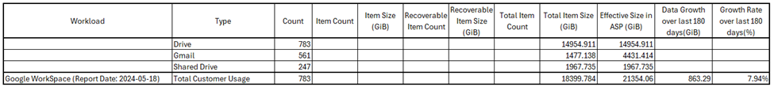

# Google Workspace sizing

## Authentication mode

The sizing tool uses **OAuth 2.0 client credentials** for authentication with Google services. Configure OAuth 2.0 client credentials as described below before running the script.

## Prerequisites

1. Open the [Google Cloud Console](https://console.cloud.google.com/).
2. Select an existing project or create a new project.
3. Click **Enable APIs and Services**.
4. Search for and enable:
   - **Admin SDK API**
   - **Google Drive API**
5. Open the **OAuth consent screen** tab.
6. If asked for User Type, select **External**, then **Create**.
7. Enter an application name (e.g. `SizingApp`) and a Google email address. Click **Save and Continue**.
8. Click **Add or Remove Scopes**, select the following scopes, then **Update**:
   - `../auth/admin.reports.usage.readonly`
   - `../auth/drive`
   - `../auth/drive.readonly`
9. Click **Save and Continue**.
10. Click **Add Users**, enter your Google email address, then **Add** → **Save and Continue**.
11. Open the **Credentials** tab → **Create Credentials** → **OAuth client ID**.
12. Set Application type to **Desktop app**.
13. Enter a name (e.g. `SizingAppCredentials`).
14. Note the **Client ID** and **Client secret**.

## Steps to run the script

1. Run PowerShell as an administrator.
2. Disable PowerShell QuickEdit Mode (right-click the PowerShell title bar → Properties → uncheck QuickEdit Mode).
3. Start the script from the PowerShell console.
4. Select **Google** to start sizing for Google services.
5. When prompted, enter the Client ID and Client secret from the prerequisites.
6. A browser window opens. Sign in with a Google account that has valid access.
7. Allow access to the scopes required by the sizing tool.
8. Copy the generated authorization code.
9. Return to the script and paste the authorization code.
10. The script continues and collects information from Google services.
11. The report is exported as CSV next to the script: `Cohesity-Sizing-YYYYMMDD-HHMMSS.csv`.

## Logs

Logs are created next to the script:

`Cohesity-Sizing-Tool-YYYYMMDD-HHMMSS.log`

## Important notes

While collecting Google usage, some report APIs may fail because reports for the latest dates are not yet available. The sizing tool checks previous dates and fetches the latest available report.

## Sample output

## Output

### Drive and Shared Drive

| Row / field | Description |
|-------------|-------------|
| Drive | Number of users using Google Drive |
| Shared Drive | Number of shared drives |
| Total Item Size | Size of all drives |

### Gmail

| Field | Description |
|-------|-------------|
| Gmail | Number of users using Gmail |
| Effective Size in ASP (CASP only) | Size required once backed up with Cohesity Alta SaaS Protection; multiplication factor **3** for Gmail |

### Total Customer Usage

| Field | Description |
|-------|-------------|
| Report Date | Latest date on which the Google report is available |
| Total Item Size / Effective Size in ASP | Totals for Drive, Gmail, and Shared Drive |
| Growth rate | Comparison against the usage report from 180 days earlier |
