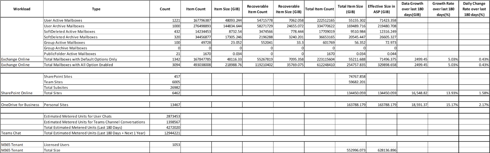

# Microsoft 365 sizing

## Prerequisites

The system running this script must have the following PowerShell modules installed. If an unsupported version of any module is found, the environment check fails. Installed modules must match these requirements.

| Component | Required version |
|-----------|------------------|
| ThreadJob | 2.0.3 or later |
| Microsoft.Graph | 2.19.0 or later |
| SharePointPnPPowerShellOnline | 3.29.2101.0 or later |
| ExchangeOnlineManagement | 3.5.1 or later |
| Windows PowerShell | 5.1 |
| PnP.PowerShell | Must **not** exist |

To get the installed modules with all versions, run the following PowerShell command.

```powershell
Get-InstalledModule -Name <module> -AllVersions
```

## Authentication modes

The script supports three authentication modes.

### 1. Login with admin user credentials (`UserLogin`)

- Multi-factor authentication (MFA) should be disabled for the user used by the script. If MFA is enabled, non-interactive authentication for M365 fails. In that case Exchange may prompt for interactive login, but SharePoint data collection might fail.
- Requires user credentials with admin access to Exchange Online and SharePoint Online.
- If authentication fails, the script falls back to interactive login.

### 2. Azure AD app-only authentication (application created by the script)

- The user running the script needs **Global Administrator** access to create an Application Registration.
- The script creates an Azure AD application. **Admin consent must be granted manually** to this app.

**Microsoft Graph** (storage usage reports):

- `Reports.Read.All` (Application)
- `User.Read.All` (Application)

**SharePoint** (site storage usage):
[See Reference](https://github.com/pnp/PnP-PowerShell/tree/master/Samples/SharePoint.ConnectUsingAppPermissions)

- `Sites.FullControl.All` (Application)
- `User.Read.All` (Application)

**Office 365 Exchange Online** (mailbox usage):

- `Exchange.ManageAsApp` (Application)
- The application must be assigned the **Exchange Administrator** role.

### 3. Azure AD app-only authentication (application created by the user) (`CustomApp`)

To use Exchange Online PowerShell with application authentication, the application must use **certificate-based authentication**.

1. Create an application with the permissions listed under application authentication above.
2. Create a self-signed certificate:

```powershell
New-SelfSignedCertificate -CertStoreLocation "cert:\CurrentUser\My" `
  -Subject "CN=CohesitySizingTool" `
  -KeySpec Signature `
  -KeyExportPolicy Exportable
```

3. Note the certificate **thumbprint**.
4. Upload the certificate to the application registration.
5. If you already have a `.cer` for the application, install it on the computer running the script in the user certificate store (`cert:\CurrentUser\My`).

## Steps to run the script

1. Run PowerShell as an administrator.
2. Disable PowerShell QuickEdit Mode (right-click the PowerShell title bar → Properties → uncheck QuickEdit Mode).
3. Start the script from the PowerShell console.
4. If the script is not the latest version, it prompts you to download the latest. Prefer running the latest version.
5. Select **M365** to start sizing for M365 services.
6. Select the M365 services for which you need a usage report.
7. When prompted, enter the SharePoint Online admin URL (usually `https://<tenant>-admin.sharepoint.com`).
8. Optionally limit Exchange Online and OneDrive scope to users in a specific AD group.
9. Optionally get the count of subsites from all SharePoint Online sites (SharePoint sites, Groups, Teams sites, etc.).
10. If the AD group option was selected, provide the display name of the AD group. For multiple groups, enter display names separated by commas.
11. Select the authentication mode (see above).
12. The environment check runs and reports whether the system meets requirements.
13. For script-created application authentication, grant admin consent to the app. ([See Reference](https://learn.microsoft.com/en-us/entra/identity/enterprise-apps/grant-admin-consent?pivots=portal#grant-admin-consent-in-app-registrations-pane))
14. Assign the Exchange Administrator role to app for collecting Exchange Online statistics. ([See Reference](https://learn.microsoft.com/en-us/entra/identity/role-based-access-control/manage-roles-portal))
15. For `UserLogin`, complete the Microsoft Graph login window with admin credentials.
16. For script-created `Application` mode, the script uses the application created in the previous step.
17. For `CustomApp`, enter tenant ID, organization name, application ID, and certificate thumbprint when prompted.
18. The report is exported as CSV next to the script: `Cohesity-Sizing-YYYYMMDD-HHMMSS.csv`.
19. The script disconnects sessions used during collection.
20. An information message confirms completion; Azure AD applications created by the script can be removed when no longer needed.

## Logs

Logs are created next to the script:

`Cohesity-Sizing-Tool-YYYYMMDD-HHMMSS.log`

## Sample output



## Output — Exchange Online

The sizing tool collects statistics for:

- User active mailboxes
- User archive mailboxes
- Other mailboxes (for example room and equipment mailboxes)
- Shared mailboxes
- Soft-deleted mailboxes (`IsInactiveMailbox` = True)
- Group mailboxes
- Public folder mailboxes

It also collects the size of the **Recoverable Items** folder of each mailbox.

For the AD group option, supported group types are:

- Microsoft 365 groups
- Distribution lists
- Security groups

### Column meanings

| Concept | Description |
|---------|-------------|
| Total Mailboxes with All Options Enabled | Statistics with all options; each row is a mailbox type |
| Item Count / Item Size | Visible items from all folders in the mailbox |
| Recoverable Item Count / Size | Soft-deleted items |
| Total Item Count | Item Count + Recoverable Item Count |
| Total Item Size | Item Size + Recoverable Item Size |
| Effective Size in ASP (CASP only) | Size required once backed up with Cohesity Alta SaaS Protection; multiplication factor **1.29495** for Exchange Online |
| Growth rate | From Graph APIs over the last **180 days** (user mailboxes only) |
| Daily Change Rate | Average of daily percent change over 180 days |

## Output — SharePoint Online and OneDrive for Business

| Field | Description |
|-------|-------------|
| Total Subsites | Total subsites under SharePoint sites, Groups, Teams sites, etc. |
| Total Sites | SharePoint sites + Team sites |
| Growth rate | Site/OneDrive usage statistics over the last 180 days (Graph APIs) |
| Daily Change Rate | Average of daily percent change over 180 days |

## Output — Teams Chat

| Field | Description |
|-------|-------------|
| Estimated Metered Units for User Chats | Proportional to messages sent by all users in private chat (one-on-one or group) in the last 180 days |
| Estimated Metered Units for Teams Channel Conversations | Proportional to messages/posts/replies in team channels in the last 180 days |
| Total Estimated Metered Units (Last 180 Days) | Private chat units + channel conversation units |
| Total Estimated Metered Units (Last 180 Days + Next 1 Year) | Estimate based on last 180 days plus next 365 days |

## Output — M365 overall statistics

| Field | Description |
|-------|-------------|
| Licensed Users | Number of licensed users in the M365 tenant |
| Total Size | Total data size for Exchange Online, SharePoint Online, and OneDrive |

The final CSV includes combined data size. For more detailed per-item numbers, refer to the logs in the script directory.
