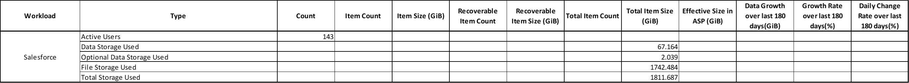

# Salesforce sizing

## Authentication mode

The sizing tool uses **Salesforce External Client App** credentials (client credentials flow) to authenticate to the Salesforce organization.

## Prerequisites

### 1. Clone the System Administrator profile

1. Go to **Setup → Profiles**.
2. Clone **System Administrator** to a new profile, for example `Cohesity Salesforce Sizing Admin`.

### 2. Create a user for sizing

1. Go to **Setup → Users**.
2. Create a new user for sizing (name, email, etc.). Example: `admin@cohesity-sizing.com`.
3. Assign the profile created above (`Cohesity Salesforce Sizing Admin`).

### 3. Create an External Client App

1. Go to **Setup → External Client App Manager**.
2. Create a new app with basic information.
3. Enable OAuth settings.
4. Enable **Client Credentials Flow**.
5. Under OAuth scopes, select **Manage user data via APIs (api)**.
6. Set callback URL to `https://localhost/callback` (the script does not use this URL).
7. Create/save the app.

### 4. Assign policies to the app

1. Open the app’s **Manage** page and click **Edit Policies**.
2. Set:
   - **Selected Profiles** = profile created above
   - **Permitted Users** = Admin approved users are pre-authorized
   - Enable client credential flow
   - **Run As** = user created above
3. Save the app.

### 5. Get Client ID and Secret

1. Open the app.
2. Go to **OAuth Settings → Consumer Key and Secret**.
3. Copy:
   - **Consumer Key** → Client ID
   - **Consumer Secret** → Client Secret

## Steps to run the script

1. Run PowerShell as an administrator.
2. Disable PowerShell QuickEdit Mode (right-click the PowerShell title bar → Properties → uncheck QuickEdit Mode).
3. Start the script from the PowerShell console.
4. Select **Salesforce** to start sizing for the Salesforce org.
5. Enter the Salesforce login URL.
6. Enter the External Client App Client ID.
7. Enter the External Client App Client Secret.
8. The script collects information from the Salesforce org.
9. The report is exported as CSV next to the script: `Cohesity-Sizing-YYYYMMDD-HHMMSS.csv`.

## Logs

Logs are created next to the script:

`Cohesity-Sizing-Tool-YYYYMMDD-HHMMSS.log`

## Sample output

## Output

| Field | Description |
|-------|-------------|
| Active users count | Users with `isActive` = true |
| Data storage used | Total structured data used by the org |
| Optional data storage used | Structured data when optional object backup is enabled |
| File storage used | Total unstructured blob data size |
| Total storage used | Combined size of all individual storage sizes |
